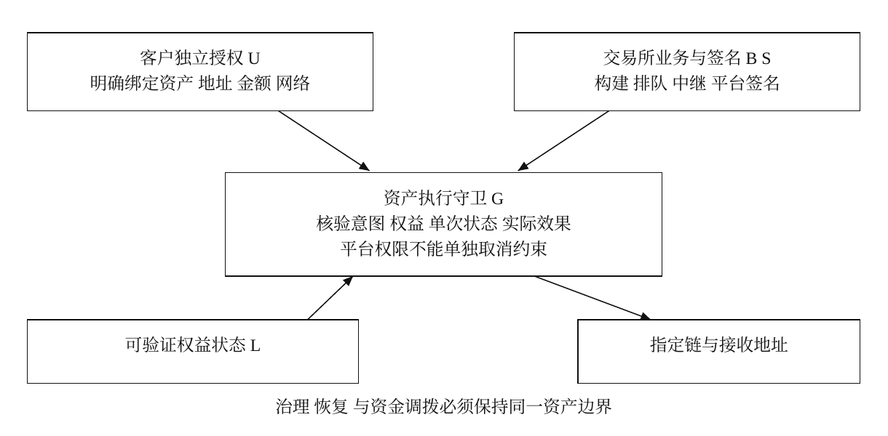

# 中心化交易所提币授权的抗合谋与抗胁迫机制研究

**基于独立用户意图与全路径资产约束的设计框架**

Independent research on custodial withdrawal authorization under insider collusion and coercion. Includes a Chinese paper, conditional security arguments, and a reproducible bounded abstract model.

**作者：Koji Tamaki** · 独立研究者  
邮箱：[kojitamaki223@gmail.com](mailto:kojitamaki223@gmail.com)  
GitHub：[mavis-codee](https://github.com/mavis-codee)  
版本：1.0 · 2026 年 11 月 9 日

## 为什么研究这个问题

如果交易所员工被收买、签名托管人员受胁迫，甚至管理层受威胁，哪些可验证约束仍能阻止未经客户授权的资产转移？

这篇论文从这个问题出发，区分密钥保密、平台签名权限与客户的真实授权。签名能够通过链上验证，并不足以证明对应客户同意了资产转移。

研究目标是限制平台人员失陷后能够产生的资产效果。本文讨论客户独立授权、真实权益验证、单次执行，以及覆盖治理、恢复和资金调拨的资产约束。

## 阅读与下载

- [完整中文版 PDF（11 页）](Custodial_Withdrawal_Authorization_zh.pdf)
- [完整中文版 Markdown](Custodial_Withdrawal_Authorization_zh.md)
- [论文排版源文件](source/paper.md)
- [模型程序](source/model_check.py)与[完整运行结果](source/model_results.json)
- [来源核对与证据边界](SOURCE_NOTES.md)
- [发布配图](social/research_announcement_zh.png)与[论文首页图片](social/paper_first_page.png)

如需直接下载 PDF，可以打开上面的 PDF 文件后选择下载；完整源码可通过仓库的 **Code → Download ZIP** 获取。

## 核心观点

1. **有效签名与客户授权需要分别验证。** 私钥没有泄露，也不能单独排除签名权限被滥用的可能。
2. **多签和门限签名具有明确的失陷边界。** 当足够多的平台签名参与者受控制时，普通账户不能仅凭原有门限继续约束他们。
3. **资产退出需要独立约束。** 客户授权、真实可提权益和单次执行状态必须一致；规则需要对实际资产花费有强制力。
4. **管理和恢复不能成为旁路。** 升级、恢复、冷热调拨与附加授权都需要保持同一保护边界。
5. **防止盗取与持续提供提款服务是两个目标。** 不能满足安全条件时拒绝支出，并不意味着资产已经被盗。



## 研究范围与完成程度

本文属于**概念框架、条件性安全分析和有界模型检验**，尚未完成生产协议实现，未经同行评审。论文不构成对真实交易所的渗透测试或内部系统审计。

强安全命题保留客户授权根未失陷、权益证明可靠、资产守卫正确执行、治理恢复不能取消约束以及链安全等假设。可验证交易账本和各链资产守卫仍需进一步实现与验证。客户本人受胁迫或其独立授权终端失陷，不在本文强命题覆盖范围内。

币安等公开事件用于说明研究动机，不用于认定员工主动参与盗窃；本文也没有确认欧易存在可利用漏洞。与客户意图绑定有关的已有研究在论文相关工作与参考文献中列明。

## 复现抽象模型

需要 Python 3.10 或更高版本；模型仅使用标准库，不访问真实交易所、私钥或资金。在仓库根目录运行：

```bash
python source/model_check.py
```

程序会更新 `source/model_results.json`。当前结果为：

| 控制配置 | 出现反例的能力组合 | 迁移尝试数 |
| --- | --- | --- |
| 普通账户与平台门限签名 | 12 / 16 | 864 |
| 完整资产守卫 | 0 / 16 | 864 |
| 移除客户意图验证 | 8 / 16 | 864 |
| 移除权益真实性约束 | 8 / 16 | 2,304 |
| 移除单次执行约束 | 16 / 16 | 864 |
| 允许治理绕过 | 8 / 16 | 1,440 |
| 允许恢复绕过 | 8 / 16 | 1,296 |

合计 **112 个配置、8,496 次迁移尝试**。分母 16 是四个二值能力形成的组合数，不是风险概率。搜索深度为 5，初始资金为 2 个抽象单位；签名和权益证明使用理想化谓词。没有发现反例，仅适用于声明的有限模型范围。

## 重新生成与检查 PDF

在仓库根目录运行：

```bash
python -m pip install -r requirements.txt
python source/model_check.py
python source/build_pdf.py
python source/verify_pdf.py
```

重建 PDF 输出至 `output/pdf/Custodial_Withdrawal_Authorization_Paper/`，不会覆盖仓库根目录的已发布 PDF。排版器同时生成 `source/layout.json` 与 `source/assets/architecture.pdf`；检查器更新 `source/quality_check.json`。

正文采用 A4 单栏、11 pt 思源宋体派生字体；标题采用思源黑体派生字体，英文采用 Tinos，代码采用 Source Code Pro。所需字体及其许可证在 `source/fonts/` 中。发布 PDF 的全部字体已嵌入；检查记录包括 217 个唯一文本块，未检出文本缺失或页面边界溢出，并已逐页进行视觉检查。

当前中文字体为覆盖本文的静态子集，内部名称为 Tamaki Paper Serif 与 Tamaki Paper Sans。新增正文字符可能需要补充字体；修改排版后也应重新渲染并逐页检查。

## 文件完整性

`MANIFEST.json` 记录发布文件的 SHA-256，保留发布时的字节内容。模型运行结果记录了 `source/model_check.py` 的 SHA-256，因此仓库关闭自动换行转换，避免不同系统的换行规则改变校验值。

## 引用、反馈与制作说明

引用本项目时可标注：Koji Tamaki. 中心化交易所提币授权的抗合谋与抗胁迫机制研究：基于独立用户意图与全路径资产约束的设计框架. 版本 1.0, 2026-11-09. 本仓库地址。

欢迎通过 Issues 提出技术问题，特别是权益真实性、资产出口完整性、治理恢复旁路及模型遗漏。请注明相关章节或代码位置，并说明前提、反例或依据。

研究构想与作者署名为 Koji Tamaki。AI 辅助用于资料检索、论证组织、模型编写与排版；模型结果由随附程序实际运行生成。正文和代码暂未指定独立开源许可证；第三方字体遵循各自随附许可证。
